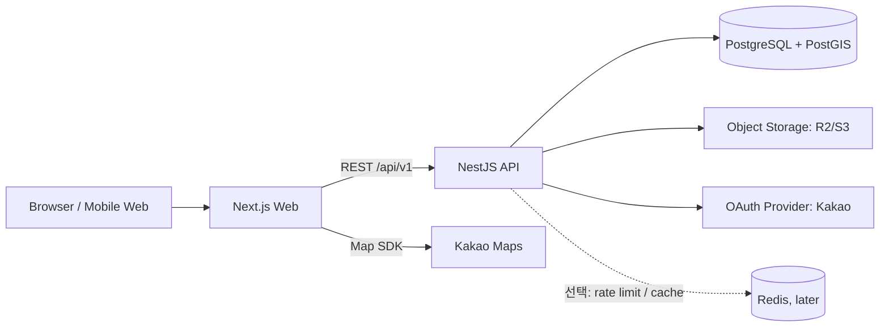

# FullCourse 아키텍처 및 설계안

## 1. 제품 방향과 설계 원칙

FullCourse는 부산 맛집을 지도와 검색으로 발견하고, 식당 정보를 확인한 뒤 리뷰와 저장 목록으로 이어지는 서비스다. 취업 포트폴리오와 2~3인 협업을 기준으로 다음 원칙을 둔다.

- **모듈형 모놀리스**: 처음부터 마이크로서비스를 나누지 않고, 하나의 API 애플리케이션 안에서 도메인 모듈과 책임을 분리한다.
- **검색·지도 경험을 우선**: 부산 행정구역, 좌표, 카테고리, 영업 여부, 가격 등 조합 검색과 지도 결과를 우선 완성한다.
- **MVP는 검증 가능한 범위로**: 식당 데이터, 검색/상세, 회원, 리뷰, 좋아요, 북마크를 먼저 구현한다. 대댓글, 배지, 고도화된 개인화는 후속 단계다.
- **데이터 출처를 기록**: 식당/메뉴 정보에 출처와 확인 시점을 남기고, 무단 크롤링 대신 직접 입력·제휴·사용 허가된 데이터로 시작한다.
- **API 계약과 작업 경계 공유**: OpenAPI를 기준으로 프론트엔드와 백엔드가 병렬 작업하고, DB 변경은 마이그레이션으로 관리한다.

## 2. 권장 기술 스택

| 영역 | 권장 | 이유 / 적용 범위 |
|---|---|---|
| 웹 | Next.js (App Router), React, TypeScript | 검색·상세 페이지의 SEO, 서버 렌더링, 풍부한 생태계 |
| UI | Tailwind CSS, shadcn/ui | 빠르게 일관된 UI를 만들고 컴포넌트를 함께 관리하기 쉬움 |
| 서버 상태 | TanStack Query | API 캐시, 검색 필터 변경, 페이지네이션 처리 |
| 폼/검증 | React Hook Form + Zod | 폼과 클라이언트 검증을 단순화 |
| 지도 | Kakao Maps JavaScript SDK | 부산 지역 사용자에게 익숙한 지도·장소 맥락. 키 제한과 약관 확인 필요 |
| API | NestJS, TypeScript, REST, Swagger/OpenAPI | 모듈·DTO·가드 구조가 분명해 협업 및 포트폴리오 설명에 적합 |
| DB | PostgreSQL + PostGIS | 관계형 데이터와 좌표 반경/지도 영역 검색을 한 DB에서 처리 |
| ORM | Prisma | 스키마·마이그레이션·타입 안전성. 공간 질의는 검증된 raw SQL 사용 |
| 이미지 | Cloudflare R2 또는 S3 호환 객체 저장소 | 리뷰 사진을 DB에 넣지 않고 파일로 저장. DB에는 키와 메타데이터 저장 |
| 로그인 | Kakao OAuth 우선, Google은 선택 | 국내 타깃에 맞춰 로그인 범위를 제한. OAuth 계정 연결은 내부 사용자 ID에 매핑 |
| 배포 | Docker Compose 로컬, Vercel(웹) + Render/Fly.io API + 관리형 PostgreSQL | 팀이 운영 부담을 줄이고 실제 배포·환경변수 경험을 보여줄 수 있음 |
| 자동화 | GitHub Actions | lint, typecheck, 단위/통합 테스트, 빌드 및 마이그레이션 검증 |

**초기에는 넣지 않을 것:** 마이크로서비스, Kubernetes, Kafka, 별도 검색엔진, Redis. PostgreSQL의 PostGIS와 trigram 검색으로 데이터 규모가 작은 포트폴리오 MVP를 충분히 다룬다. 측정 결과가 나올 때만 캐시나 전용 검색엔진을 추가한다.

### 인증 권장안

OAuth 제공자 토큰은 서버에서 교환하고, 제공자별 `(provider, provider_subject)`를 `oauth_accounts`에 저장해 내부 `users.id`와 연결한다. 브라우저에는 `HttpOnly`, `Secure`, `SameSite` 쿠키 기반 세션/refresh credential을 사용하고, 로그아웃·재발급·계정 연결 정책을 문서화한다. OAuth client secret은 서버에만 둔다.

## 3. 시스템 구성



초기 배포는 웹, API, PostgreSQL 세 요소면 충분하다. 지도 표시용 SDK는 웹에서 쓰되, 장소 검색/좌표 변환이 필요하면 제공자 약관을 확인해 서버 경유 여부와 저장 가능 범위를 결정한다. 지도 SDK 키는 허용 도메인을 제한한다.

## 4. 저장소 디렉터리 구조

pnpm workspace 기반 모노레포를 권장한다. 공통 타입을 무리하게 공유하지 말고, API 계약은 OpenAPI로 공유한다.

```text
fullcourse/
├─ apps/
│  ├─ web/                         # Next.js
│  │  ├─ src/app/                  # 라우트: 탐색, 식당 상세, 마이페이지
│  │  ├─ src/features/             # search, restaurant, review, bookmark, auth
│  │  ├─ src/components/           # 공통 UI
│  │  ├─ src/lib/                  # API client, env, 지도 어댑터
│  │  └─ public/
│  └─ api/                         # NestJS
│     └─ src/
│        ├─ main.ts
│        ├─ common/                # 필터, 예외, 로깅, 가드
│        ├─ auth/                  # OAuth, 세션/토큰, 현재 사용자
│        ├─ users/
│        ├─ restaurants/           # 식당 CRUD, 상세, 운영시간
│        ├─ search/                # 지도/목록 검색, 자동완성
│        ├─ categories/            # 음식 카테고리와 태그
│        ├─ reviews/               # 리뷰, 사진, 좋아요, 댓글
│        ├─ bookmarks/             # 폴더와 저장
│        ├─ uploads/               # presigned upload 정책
│        └─ admin/                 # 데이터 검수/신고 처리(간단한 관리자 기능)
├─ packages/
│  ├─ eslint-config/
│  └─ tsconfig/
├─ prisma/
│  ├─ schema.prisma
│  ├─ migrations/                  # PostGIS 및 인덱스 SQL 포함 가능
│  └─ seed.ts                      # 사용 허가된 부산 샘플 데이터
├─ docs/
│  ├─ architecture.md
│  ├─ api.md                       # 생성된 Swagger 링크/계약 메모
│  └─ decisions/                   # 주요 ADR
├─ infra/
│  └─ docker-compose.yml           # 로컬 PostgreSQL(+ PostGIS)
├─ .github/workflows/
├─ .env.example
├─ pnpm-workspace.yaml
└─ README.md
```

각 feature/module 안에서는 `controller → service → repository/query` 책임을 나누되, 작은 기능에 불필요한 계층을 강제하지 않는다. 프론트엔드는 페이지 단위보다 도메인 기능 단위로 컴포넌트와 API 호출을 둔다.

## 5. 데이터베이스 스키마

UUID 기본키, `created_at`, 필요한 테이블의 `updated_at`, 소프트 삭제 또는 상태값을 사용한다. 시간은 DB에 UTC로 저장하고 API에서 ISO-8601로 주고받는다. 금액은 정수 원 단위다.

### 핵심 테이블

| 테이블 | 주요 컬럼 / 관계 |
|---|---|
| `users` | `id`, `nickname`, `email` nullable, `profile_image_url`, `role` (`USER/ADMIN`), `status`, timestamps |
| `oauth_accounts` | `id`, `user_id FK`, `provider`, `provider_subject`, timestamps; `UNIQUE(provider, provider_subject)` |
| `restaurants` | `id`, `name`, `slug`, `description`, `phone`, `address`, `road_address`, `district`, `neighborhood`, `location geography(Point,4326)`, `price_level`, `parking_available`, `status`, `source`, `verified_at`, timestamps |
| `categories` | `id`, `name`, `slug`, `parent_id nullable`; 계층형 음식 분류 |
| `restaurant_categories` | `restaurant_id`, `category_id`; 복합 PK |
| `tags` | `id`, `name`, `slug`, `tag_type` (방문목적/편의/특징) |
| `restaurant_tags` | `restaurant_id`, `tag_id`; 복합 PK |
| `menus` | `id`, `restaurant_id FK`, `name`, `price_krw`, `image_key nullable`, `is_signature`, `sort_order`, `updated_at` |
| `business_hours` | `id`, `restaurant_id FK`, `day_of_week`, `open_time`, `close_time`, `break_start`, `break_end`, `is_closed`; 분할 영업은 복수 행으로 지원 |
| `restaurant_closures` | `id`, `restaurant_id FK`, `closed_on`, `note`; 임시 휴무/공휴일 안내 |
| `reviews` | `id`, `restaurant_id FK`, `user_id FK`, `rating` 1–5, `taste_rating`, `service_rating`, `mood_rating` nullable, `body`, `visit_date` nullable, `status`, timestamps; MVP 정책에 따라 사용자당 식당별 리뷰 1개 (`UNIQUE(user_id, restaurant_id)`) |
| `review_photos` | `id`, `review_id FK`, `object_key`, `sort_order`, `alt_text` |
| `review_likes` | `user_id`, `review_id`; 복합 PK, 자기 리뷰 좋아요는 금지 |
| `review_comments` | `id`, `review_id FK`, `user_id FK`, `parent_id nullable`, `body`, `status`, timestamps; 1단계 댓글만 노출하고 깊이는 제한 |
| `bookmark_folders` | `id`, `user_id FK`, `name`, `visibility`, `sort_order`, timestamps |
| `bookmarks` | `folder_id`, `restaurant_id`; 복합 PK, `created_at` |
| `reports` | `id`, `reporter_id`, `target_type`, `target_id`, `reason`, `status`, timestamps |

`restaurants`에 모든 리뷰 집계값을 저장하며 시작하지 않는다. 검색/상세에서는 `AVG(reviews.rating)`와 개수를 조회하고, 실제 성능 문제가 확인되면 캐시/집계 컬럼을 도입한다. 운영시간은 임시 휴무와 자정 넘김 영업이 표현되도록 저장/응답 규칙을 정한다.

### 필수 인덱스와 제약

- `restaurants.location`: GiST 인덱스; 지도 영역과 반경 질의
- `restaurants(district, neighborhood, status)`, `restaurants(status, created_at)`
- 이름 검색: `pg_trgm` GIN 인덱스와 정규화된 이름/검색 텍스트. PostgreSQL 한글 전문 검색의 형태소 품질은 별도 확인
- `reviews(restaurant_id, created_at DESC)`, `reviews(user_id, created_at DESC)`
- `menus(restaurant_id)`, `business_hours(restaurant_id, day_of_week)`
- 북마크/좋아요의 복합 PK로 중복 저장/좋아요 차단
- 식당 좌표는 PostGIS `geography(Point,4326)`로 저장하고 응답은 `[longitude, latitude]`로 일관화

## 6. REST API 초안

공통 prefix는 `/api/v1`. JSON 응답, ISO-8601 UTC 날짜, 일관된 에러 형식 `{ "code": "...", "message": "...", "details": ... }`. 목록은 `limit` 상한을 두고, 리뷰 등 큰 목록은 cursor pagination을 쓴다. Swagger UI를 개발 환경에서 제공한다.

### 탐색과 검색

| Method | Endpoint | 설명 / 주요 입력 |
|---|---|---|
| `GET` | `/restaurants` | 목록 검색: `q`, `category`, `tags[]`, `district`, `neighborhood`, `priceMin`, `priceMax`, `parking`, `openNow`, `lat`, `lng`, `radiusM`, `bbox`, `sort`, `cursor`, `limit` |
| `GET` | `/restaurants/map` | 지도 전용 경량 결과: `bbox=west,south,east,north`, 검색 필터; 지도 마커용 필드만 반환, 최대 건수 제한 |
| `GET` | `/search/suggestions?q=` | 식당명/지역/메뉴 자동완성, 최소 입력 길이와 결과 수 제한 |
| `GET` | `/categories` | 계층형 음식 카테고리 |
| `GET` | `/tags` | 방문 목적/편의 필터 목록 |
| `GET` | `/districts` | 부산 구·군 및 동 목록; 실제 운영 데이터 기준 |
| `GET` | `/restaurants/:restaurantId` | 기본 정보, 운영시간, 카테고리, 메뉴, 평점 요약 |
| `GET` | `/restaurants/:restaurantId/reviews` | 정렬·cursor 기반 리뷰 목록 및 사진/좋아요 수 |

검색은 좌표 반경 또는 bbox 중 하나를 받도록 하고, 둘 다 오면 명시적으로 오류 처리한다. `openNow`는 식당의 현지 시간대(Asia/Seoul), 당일 휴무 및 브레이크타임을 반영한다. 지도 이동 때 매 요청마다 무제한 결과를 주지 않고 bbox/건수/응답 필드를 제한한다.

### 로그인과 내 정보

| Method | Endpoint | 설명 |
|---|---|---|
| `GET` | `/auth/kakao` | OAuth 시작 |
| `GET` | `/auth/kakao/callback` | 제공자 콜백, 계정 연결/로그인 후 쿠키 설정 |
| `POST` | `/auth/refresh` | refresh credential 회전 |
| `POST` | `/auth/logout` | 세션/refresh 폐기 |
| `GET` | `/users/me` | 내 프로필 |
| `PATCH` | `/users/me` | 닉네임/프로필 수정 |
| `GET` | `/users/me/reviews` | 내 리뷰 목록 |
| `GET` | `/users/me/bookmark-folders` | 북마크 폴더 목록 |

### 리뷰와 소셜

| Method | Endpoint | 설명 |
|---|---|---|
| `POST` | `/restaurants/:restaurantId/reviews` | 리뷰/평점 작성; 로그인 필요 |
| `PATCH` | `/reviews/:reviewId` | 본인 리뷰 수정 |
| `DELETE` | `/reviews/:reviewId` | 본인 리뷰 삭제(소프트 삭제 권장) |
| `PUT` | `/reviews/:reviewId/like` | 좋아요 설정; 멱등 |
| `DELETE` | `/reviews/:reviewId/like` | 좋아요 해제 |
| `GET` | `/reviews/:reviewId/comments` | 댓글 목록 |
| `POST` | `/reviews/:reviewId/comments` | 댓글/대댓글 작성 |
| `DELETE` | `/comments/:commentId` | 본인 댓글 삭제 또는 관리자 숨김 |
| `POST` | `/uploads/presign` | 사진 업로드용 임시 URL 발급 |
| `POST` | `/reports` | 리뷰/댓글/식당 신고 |

### 북마크

| Method | Endpoint | 설명 |
|---|---|---|
| `POST` | `/bookmark-folders` | 폴더 생성 |
| `PATCH` | `/bookmark-folders/:folderId` | 폴더명/공개 설정 수정 |
| `DELETE` | `/bookmark-folders/:folderId` | 폴더 삭제 정책에 따라 포함 북마크도 삭제 또는 기본 폴더로 이동 |
| `GET` | `/bookmark-folders/:folderId/restaurants` | 폴더의 식당 목록 |
| `PUT` | `/bookmark-folders/:folderId/restaurants/:restaurantId` | 저장; 멱등 |
| `DELETE` | `/bookmark-folders/:folderId/restaurants/:restaurantId` | 저장 해제 |

### 간단한 관리자 API

`POST/PATCH /admin/restaurants`, `PATCH /admin/restaurants/:id/status`, `GET/PATCH /admin/reports/:id`로 식당 등록·수정과 신고 처리를 지원한다. 모든 관리자 경로는 role guard와 감사 로그를 적용한다.

## 7. 검색/지도 동작 설계

1. 목록과 지도는 동일한 검색 조건을 사용하되, 지도 응답은 id/이름/좌표/대표 이미지/평점/가격대 등 카드·마커 정보로 제한한다.
2. 기본 검색은 부산 구·군/동 필터, 카테고리, 태그, 가격대, 주차로 구성한다. 사용자의 위치 권한은 선택 사항이며 거부해도 지역 선택으로 이용 가능해야 한다.
3. 위치 정렬은 `ST_DWithin`으로 반경을 제한한 뒤 `ST_Distance`로 정렬한다. 지도 영역은 bbox 조건과 GiST 인덱스를 쓴다.
4. 이름/메뉴/지역 통합 검색은 MVP에서 식당명, 등록된 메뉴명, 행정구역 이름을 대상으로 한다. trigram/정규화로 오타·부분일치를 처리하고 자동완성은 짧은 응답과 상한을 둔다.
5. 외부 지도/장소 데이터는 서비스 DB에 영구 저장 가능한지 공급자 약관을 확인한다. 사용자 제출 데이터와 운영자 검수 상태를 구분한다.

## 8. MVP 우선순위

**1차 출시**

- 부산 샘플 식당 데이터와 관리자 등록/수정
- 리스트/지도, 구·군·동·카테고리·가격·주차 필터, 텍스트 검색
- 식당 상세, 메뉴, 영업시간, 휴무일
- Kakao 로그인, 내 프로필
- 리뷰와 별점, 리뷰 사진, 좋아요
- 기본 북마크 폴더 및 저장/해제
- 반응형 UI, 로딩/빈 결과/오류 상태, OpenAPI 문서

**2차 개선**

- 대댓글/신고·관리 화면, 복수 북마크 폴더 고도화
- 배지, 공개 프로필, 공유 가능한 리스트
- 검색 개인화 및 인기 검색어
- 캐시, 비동기 이미지 처리, Redis/전용 검색엔진(측정 후 결정)

## 9. 협업 및 품질 기준

- 2인이라면 한 명은 탐색/식당 도메인, 다른 한 명은 인증/리뷰/북마크를 맡고, API 계약과 DB 공통 규칙은 함께 합의한다. 프론트/백으로 고정 분업하기보다 도메인 기능 단위로 PR을 나누면 포트폴리오 기여가 분명하다.
- `main` 보호, 짧은 feature branch, PR 템플릿, 리뷰 1명, 작은 커밋을 사용한다. `.env`와 OAuth/스토리지 비밀키는 커밋하지 않는다.
- 모든 API 입력을 DTO로 검증하고, 인증/인가와 소유권 확인을 서버에서 한다. 이미지 MIME·용량·확장자를 검증하고 presigned URL은 짧게 만료시킨다.
- 검색/상세/리뷰 생성/북마크·좋아요의 주요 경로에 단위 및 API 통합 테스트를 둔다. CI는 lint, typecheck, test, build를 실행한다.
- 시드 데이터는 상표·개인정보·이미지 저작권과 출처를 확인한다. 평점 집계는 숨김/삭제 리뷰를 제외하고, 리뷰 수정/삭제와 신고 이력을 관리한다.

## 10. 구현 전 팀 합의가 필요한 기본 정책

- 사용자는 식당당 리뷰를 하나만 유지하고 수정하는가, 방문할 때마다 새 리뷰를 쓸 수 있는가? MVP는 하나만 허용을 권장한다.
- 식당/리뷰의 공개 범위, 신고 기준, 관리자 역할과 숨김 절차
- 북마크 폴더 삭제 시 식당 저장도 함께 지울지 여부
- 부산 행정구역 코드/표기 기준과 식당 데이터 입력·검수 책임
- Kakao 지도/장소 API 및 이미지 저장소의 사용 조건, 비용, 키 제한

위 정책은 API 제약과 DB 제약에 직접 영향을 준다. MVP 권장값으로 우선 구현하고, README/ADR에 선택 이유를 남기면 포트폴리오 설명에 도움이 된다.
